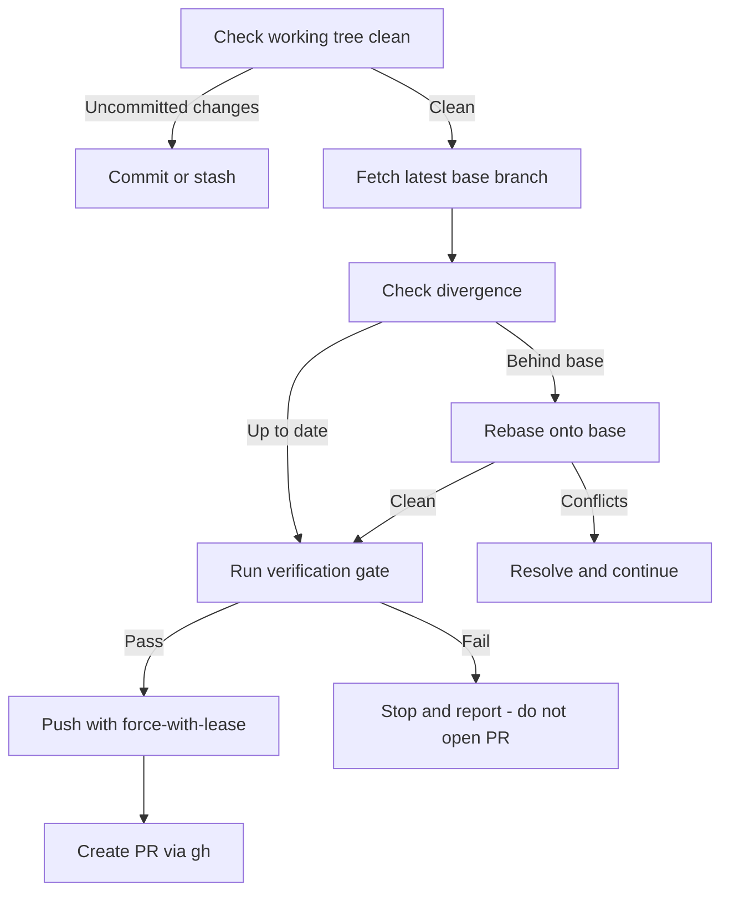

# PR Creator

Creates high-quality GitHub pull requests. Guarantees the branch is synchronized with the latest base branch, validates branch naming, generates titles conforming to Conventional Commits plus an optional ticket key, and renders a comprehensive, audit-ready description.

Reads `.speckit/orchestrator.json` for `baseBranch` (default `main`), `ticketPrefix`, `trackerBaseUrl`, and `verify` — see `speckit-workflow` for the schema. With no `ticketPrefix` configured, it runs in **ticketless mode**: branch names and titles omit the key and no tracker links are rendered.

---

## Core Guarantees

1. **Always on the latest base branch** — fetches and rebases onto `origin/<baseBranch>` before opening the PR, so reviewers never see a stale diff or a surprise conflict.
2. **Consistent branch naming** — enforces `<type>/<TICKET-KEY>-<kebab-case-slug>`.
3. **Standardized titles** — `<type>(<scope>): [<TICKET-KEY>] <imperative description>`, max 72 characters.
4. **Audit-ready body** — populates tracker links, an executive summary, architectural changes, and real verification receipts.

---

## Branch Naming

```text
<type>/<TICKET-KEY>-<kebab-case-slug>
```

| Type | Usage |
| :--- | :--- |
| `feature/` | New user-facing or platform features |
| `fix/` | Bug fixes and edge-case resolutions |
| `refactor/` | Architectural or internal cleanup |
| `test/` | Adding or restructuring test suites |
| `chore/` | Tooling, config, or dependency updates |
| `docs/` | Documentation and architecture guides |

### Normalization rules

1. The ticket key is **uppercase** (`PROJ-38`, not `proj-38`).
2. The slug is **lowercase kebab-case**, alphanumerics and hyphens only.
3. Strip trailing hyphens; keep the slug under 40 characters.
4. In ticketless mode, drop the key segment: `feature/<kebab-case-slug>`.

---

## Synchronization Protocol



```bash
# 1. Confirm the working tree is clean
git status -s

# 2. Fetch the latest base branch
git fetch origin <baseBranch>

# 3. Check divergence
git rev-list --count HEAD..origin/<baseBranch>

# 4. Rebase onto the latest base
git rebase origin/<baseBranch>

# 5. Re-verify after the rebase - a clean rebase can still break the build
<verify.typecheck>
<verify.test>

# 6. Push with upstream tracking
git push -u origin HEAD --force-with-lease
```

`--force-with-lease` rather than `--force`: it refuses the push when someone else has advanced the remote branch, so a teammate's commits cannot be silently discarded.

**Never open a PR on a failing verification gate.** Stop, report the failure with its actual output, and let the user decide.

---

## PR Title

```text
<type>(<scope>): [<TICKET-KEY>] <imperative summary>
```

- **Max length**: 72 characters
- **Mood**: imperative — "add", "integrate", "fix", never "added" or "integrates"
- **Case**: lowercase description, uppercase ticket key
- **Punctuation**: no trailing period

Examples:

- `feat(categories): [PROJ-38] integrate dynamic categories into entry form`
- `fix(storage): [PROJ-42] handle presigned upload url expiry`
- `refactor(voting): [PROJ-20] extract tally aggregation helper`

---

## PR Body

Load the template from the host project's `.github/pull_request_template.md` when it exists, otherwise fall back to `templates/pull-request-template.md` in this skill. Substitute the `{{TOKEN}}` placeholders with real branch data.

> [!NOTE]
> Render the body to a temporary, git-ignored file (for example `.speckit/pr-body.md`) and pass it with `gh pr create --body-file`. This avoids shell escaping problems with multi-line markdown. Do not commit that file.

**Fill every checkbox honestly.** A checked box means the gate ran and passed. For a gate that was skipped, mark it and name the reason. A PR body asserting passes that never ran is worse than an empty one — reviewers trust it.

---

## Execution

### Option A: GitHub CLI

```bash
gh pr create \
  --base <baseBranch> \
  --head "$(git branch --show-current)" \
  --title "feat(categories): [PROJ-38] integrate dynamic categories into entry form" \
  --body-file ".speckit/pr-body.md"
```

### Option B: Fallback when `gh` is unauthenticated

1. Push the branch: `git push -u origin <branch-name>`
2. Build the compare link:
   ```text
   https://github.com/<owner>/<repo>/compare/<baseBranch>...<branch-name>?expand=1
   ```
3. Output the link and the rendered markdown body for one-click creation.

Derive `<owner>/<repo>` from `git remote get-url origin`. Never guess it.

---

## Guardrails

- **Confirm before pushing to a shared remote.** Opening a PR is outward-facing and notifies reviewers. Unless the user has already authorized it for this run, confirm first.
- **Never force-push the base branch.** The lease protection applies to the feature branch only.
- **Never `@`-mention a bare username** in a PR body unless it is a real login the user means to notify. Put roles and placeholders in backticks.
