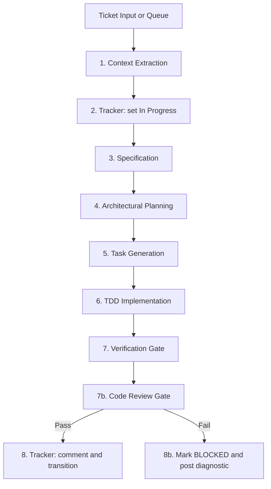

# Spec Kit Multi-Implement

Batch-processes multiple tickets through the full Spec-Driven Development lifecycle. For each ticket it generates or adapts a specification, produces an architectural plan, breaks down tasks, executes a test-driven implementation, runs verification, and synchronizes progress back to the tracker.

Where `speckit-workflow` drives **one** feature, this skill drives **many** and owns the failure isolation between them.

---

## Prerequisites

**Required**: a spec-kit project (`.specify/`), plus the pipeline skills `speckit-specify`, `speckit-checklist`, `speckit-plan`, `speckit-tasks`, `speckit-implement` from [github/spec-kit](https://github.com/github/spec-kit).

**Tracker integration** (optional): an MCP server exposing issue read, comment, and transition operations — for example the Atlassian MCP server for Jira, or the GitHub MCP server for Issues. Without one, run in **file-driven mode**: accept a list of feature descriptions or a `priority_queue.json` and skip every tracker sync step.

**Optional skills**, each skipped with a logged note when absent: `constitution-check`, `env-validator`, `atomic-commit`, `code-review`, `code-review-and-quality`, `tdd`.

Configuration comes from `.speckit/orchestrator.json` — see `speckit-workflow` for the schema and resolution rules. This skill additionally honors:

```json
{
  "tracker": {
    "inProgressState": "In Progress",
    "completeState": "In Review",
    "autoClose": false
  },
  "maxConcurrent": 2
}
```

---

## Core Capabilities

1. **Batch ingestion** — accepts a list of ticket keys (`PROJ-38, PROJ-25`), a structured `priority_queue.json`, an epic key, or plain feature descriptions.
2. **Full pipeline per ticket** — ticket context, `speckit-specify`, `speckit-plan`, `speckit-tasks`, `speckit-implement`, verification.
3. **Tracker lifecycle** — transitions to the configured in-progress state at kickoff, posts progress and completion comments, transitions to the completion state once the suites pass.
4. **Resilient state tracking** — per-ticket states `QUEUED`, `SPECIFYING`, `PLANNING`, `IMPLEMENTING`, `VERIFYING`, `COMPLETED`, `BLOCKED`. One ticket failing verification never stops the independent ones behind it.
5. **Standards enforcement** — runs the project's configured gates for every implemented story.

---

## Execution Pipeline per Ticket



---

## Step-by-Step

### Step 1: Ingest and Parse Scope

For each ticket key:

1. Fetch the issue through the tracker MCP server.
2. Extract the summary, issue type, description, acceptance criteria, target components, labels, and parent epic.
3. In file-driven mode, take the same fields from the user's description or the queue entry.

### Step 2: Transition to In Progress

Set the ticket to `tracker.inProgressState` and post the kickoff comment:

```markdown
**Spec Kit automation started**
- **Branch**: `feature/<KEY>-<slug>`
- **Pipeline**: Specification -> Architecture -> Tasks -> TDD Implementation -> Code Review Gate
```

Skip this step entirely in file-driven mode.

### Step 3: Full Lifecycle (8-Artifact Gate)

All eight canonical artifacts are mandatory before implementation — see `speckit-workflow` for the list.

1. **Feature directory** — scaffold via the adapter's `scaffold` command, or `mkdir -p`.
2. **Specification and research** (`speckit-specify`) — populate `spec.md` and `research.md` with a user story in the form *As a ... I want ... so that ...*, acceptance criteria matching the ticket's own AC verbatim where they exist, and the stack constraints driving the design.
3. **Requirements checklist** (`speckit-checklist`) — generate `checklists/requirements.md`. Include accessibility criteria for any user-facing work, at the project's stated conformance target.
4. **Plan, data model, contracts, quickstart** (`speckit-plan`).
5. **Tasks** (`speckit-tasks`) — dependency-ordered: schema, then services and API, then UI and hooks, then integration.

### Step 4: TDD Implementation

1. Strict Red-Green-Refactor using the project's existing test runner:
   - Write the failing test first.
   - Implement the minimum that satisfies it.
   - Refactor for readability, performance, and accessibility.
2. **Atomic commits** — stage and commit logical units separately (`feat(...)`, `test(...)`, `refactor(...)`). Never a mega-commit. Every intermediate commit must compile and pass its tests, so the history stays bisectable.

### Step 5: Verification Gate

Run the adapter's resolved commands, reporting each as PASSED, FAILED, or SKIPPED:

```bash
<verify.typecheck>
<verify.test>
<verify.lint>
```

Then run any configured project gates, such as `env-validator` for configuration-access discipline.

### Step 6: Code Review Gate

1. **`code-review`**, when installed — Spec axis (does the code fulfill the ticket's acceptance criteria and `spec.md` invariants?) and Standards axis (the project's documented standards plus the Fowler smell baseline).
2. **`code-review-and-quality`**, when installed — Correctness, Readability, Architecture, Security, Performance.
3. When neither is installed, review inline across those axes and label it as such.
4. **Auto-remediate** — fix every flagged issue, commit as `refactor(...)` / `fix(...)`, and re-run Step 5.

### Step 7: Post-Execution Tracker Sync

Transition to `tracker.completeState` (or the closed state when `autoClose` is true) and post:

```markdown
**Spec Kit implementation and code review complete**
- **Branch / PR**: `feature/<KEY>-<slug>`
- **Files modified**: <paths>
- **Verification**:
  - Typecheck: PASSED (0 errors)
  - Tests: PASSED (<n>/<n>)
  - Code review: PASSED (Spec, Standards, Quality axes)
```

Report counts that actually ran. Never write PASSED for a gate that was skipped.

---

## Batch Execution Tracker

Maintain a living report across the batch:

```markdown
### Spec Kit Multi-Implement Execution Report

| Ticket | Title | Stream | Status | Tests | Commits | Tracker |
|:---:|:---|:---:|:---:|:---:|:---:|:---:|
| PROJ-38 | Dynamic category integration | UI | COMPLETED | Passed | 3 | In Review |
| PROJ-20 | Core transaction engine | Backend | IN_PROGRESS | Running | 2 | In Progress |
| PROJ-25 | Share-card generator | UI | QUEUED | — | — | To Do |
```

---

## Failure Isolation and Guardrails

- **Zero cascading failure** — when a ticket fails verification, leave its work committed on its own feature branch, post the diagnostic to the tracker, mark it `BLOCKED`, and move on to the next **independent** ticket. Never carry a failure forward into the next ticket's branch.
- **Worktree isolation for parallel runs** — concurrent tickets each get their own worktree, so workers cannot clobber one another's checkout, staging area, or build cache:
  ```bash
  git worktree add .worktrees/<KEY> -b feature/<KEY>-<slug> origin/<baseBranch>
  ```
  Remove it only after the PR merges: `git worktree remove .worktrees/<KEY> --force`.
- **Respect `maxConcurrent`** — more parallel workers than configured will thrash the test runner and the tracker's rate limits.
- **Never serialize conflicting work in parallel** — tickets touching the same schema file or module must run sequentially. Shared-schema changes go first, alone.
- **Clean tree between tickets** — verify `git status -s` is empty before starting the next ticket. Never switch branches with uncommitted changes.
