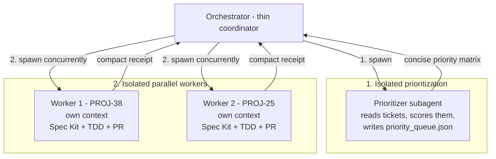

# Spec Kit Sprint Orchestrator

The master conductor for autonomous sprint delivery. It unifies backlog prioritization, multi-ticket Spec Kit development, and automated PR generation while holding **context window hygiene** as its central constraint.

---

## The Problem This Solves

### The anti-pattern: monolithic context bleed

When one agent prioritizes stories, reads dozens of tickets, drafts specifications, walks the AST, writes hundreds of lines of code, absorbs full test-runner output, and runs git commands **all in a single conversation**, the context window fills with transient detail. Reasoning quality degrades, early decisions get summarized away, and the agent starts contradicting work it did an hour ago.

### The pattern: strict isolation

The orchestrator is a **thin coordinator**. It delegates every heavy cognitive workload to a subagent with a clean context, and accepts only a compact receipt in return.



---

## Prerequisites

| Requirement | Why |
| :--- | :--- |
| Subagent support | The isolation this skill is built around is impossible without it |
| `story-prioritizer` | Phase 1 scoring and queue generation |
| `speckit-multi-implement` | Phase 3 per-ticket delivery |
| `pr-creator` | Phase 3 PR generation |
| Clean git tree, `gh` authenticated | Workers branch, push, and open PRs |

Reads `.speckit/orchestrator.json` for `baseBranch`, `ticketPrefix`, `worktreeRoot`, `verify`, and `maxConcurrent` — see `speckit-workflow` for the full schema.

Without subagent support, **stop and say so**. Running the phases inline defeats the skill's entire purpose; direct the user to `speckit-multi-implement` instead, which is designed to run in a single context.

---

## Execution Workflow

### Step 1: Launch the prioritization subagent

Spawn one research-oriented subagent so bulky ticket descriptions never enter the orchestrator's context:

> **Role**: Sprint prioritizer
> **Prompt**: Run `story-prioritizer` on `<sprint or epic>`. Fetch active unresolved tickets, score them with the multi-factor model, and write the execution queue to `.speckit/sprint/priority_queue.json`. Return ONLY a concise markdown table of the top 3–5 prioritized tickets with their assigned parallel groups — no ticket descriptions, no reasoning transcript.

In Claude Code, use the Task tool with a read-only or general-purpose subagent type. The subagent returns the compact table and the queue file path; the orchestrator never reads the raw tickets.

### Step 2: Partition into parallel streams

Read `priority_queue.json` and group tickets by `parallelGroup`. Tickets in different groups touch disjoint files and can run concurrently:

- **Group A — presentation / UI**: independent client components
- **Group B — core engine / security**: transactional and auth logic
- **Group C — storage / infrastructure**: service modules and API routes

**Serialize anything that collides.** Two tickets editing the same schema file, migration directory, or shared module belong in the same group and must run one after the other. When in doubt, serialize — a rebase conflict costs more than a sequential run.

Cap concurrency at `maxConcurrent` (default 2). More workers than that will thrash the test runner, the tracker's rate limits, and the machine.

### Step 3: Dispatch worker subagents in isolated worktrees

Launch one worker per non-conflicting ticket, each with its own context and its own git worktree:

> **Role**: Spec Kit worker — `<KEY>`
> **Prompt**: Implement ticket `<KEY>` in an isolated worktree.
> 1. Create branch `feature/<KEY>-<slug>` from the latest `origin/<baseBranch>`.
> 2. Run `speckit-multi-implement` for `<KEY>`, delivering all 8 canonical artifacts (`spec.md`, `research.md`, `data-model.md`, `contracts/`, `checklists/requirements.md`, `plan.md`, `quickstart.md`, `tasks.md`).
> 3. Enforce TDD, the project's standards gates, and atomic commits.
> 4. Run the available code review skills; resolve what they find.
> 5. Use `pr-creator` to rebase onto the latest base branch and open a PR.
> 6. Return ONLY a structured completion receipt: PR URL, test results, review confirmation, commit summary. No file contents, no test logs.

Give each worker its own worktree so concurrent workers never share a checkout:

```bash
# 1. Fetch the latest base branch
git fetch origin <baseBranch>

# 2. Spawn an isolated worktree for this story
git worktree add <worktreeRoot>/<KEY> -b feature/<KEY>-<slug> origin/<baseBranch>

# 3. Run the lifecycle inside it
cd <worktreeRoot>/<KEY>
# ... Spec Kit lifecycle, TDD, atomic commits, review gate, pr-creator ...

# 4. Clean up only after the PR has merged
cd -
git worktree remove <worktreeRoot>/<KEY> --force
```

### Step 4: Await receipts

Stop calling tools and wait. When each worker finishes it delivers a compact receipt:

```markdown
### Execution receipt: PROJ-38
- **Ticket**: PROJ-38
- **Branch**: `feature/PROJ-38-dynamic-category-integration`
- **Pull request**: <url>
- **Status**: PASSED
- **Tests**: 12/12 passing
- **Typecheck**: 0 errors
- **Commits**:
  - `feat(categories): add dynamic division dropdown to the entry form`
  - `feat(roster): render category filter pills on the public page`
  - `test(categories): cover dynamic filter behavior`
```

Do not poll a worker for progress, and never fabricate or predict a pending worker's result. When the user asks before a receipt arrives, say the worker is still running.

### Step 5: Final sprint report

Once every worker has reported, compile the summary:

```markdown
# Sprint Orchestration Summary

| Key | Feature | Status | Branch | PR | Verification |
|:---:|:---|:---:|:---|:---:|:---:|
| PROJ-38 | Dynamic category integration | Ready | `feature/PROJ-38-dynamic-category` | #45 | 12/12 pass |
| PROJ-25 | Share-card generator | Ready | `feature/PROJ-25-share-card` | #46 | 8/8 pass |
| PROJ-20 | Core transaction engine | Blocked | `feature/PROJ-20-transactions` | — | 2 failures |
```

Report blocked and skipped work as prominently as the successes. A sprint report that hides a failure is worse than no report.

---

## Context Hygiene Principles

1. **Subagents never share scratchpads.** Each worker has an independent context. Test traces, lint warnings, and terminal output stay inside the worker.
2. **Compact contracts only.** Orchestrator to worker: ticket key, title, AC summary, target branch. Worker to orchestrator: the receipt. Nothing else crosses the boundary.
3. **Workspace discipline.** One worker, one branch, one worktree. The orchestrator itself never edits files.
4. **The orchestrator stays thin.** If you find yourself reading source files or test output in the orchestrator context, delegate it instead.
