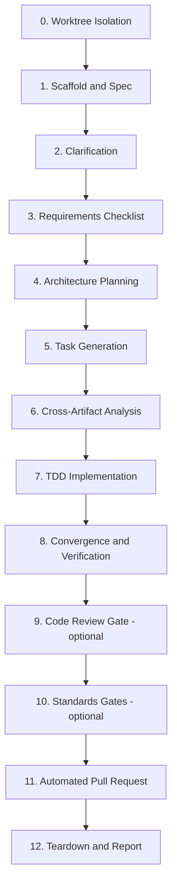

# Spec Kit End-to-End Workflow Orchestrator

Orchestrates the full Spec-Driven Development (SDD) lifecycle inside an **isolated git worktree** rooted at the latest `origin/<base-branch>`, progressing through requirements, architecture, tasks, test-driven implementation, verification, and **automated pull request creation**.

This skill is a **conductor**. It does not itself write specs or code — it sequences the `speckit-*` pipeline skills from [github/spec-kit](https://github.com/github/spec-kit) and enforces the gates between them.

---

## Prerequisites

**Required** — this skill fails fast without them:

| Requirement | Check |
| :--- | :--- |
| `git` with worktree support | `git worktree list` |
| GitHub CLI, authenticated | `gh auth status` |
| A spec-kit project | `.specify/` directory exists |
| Spec Kit pipeline skills | `speckit-specify`, `speckit-clarify`, `speckit-checklist`, `speckit-plan`, `speckit-tasks`, `speckit-analyze`, `speckit-implement`, `speckit-converge` |

Install the pipeline skills with the Spec Kit CLI:

```bash
uvx --from git+https://github.com/github/spec-kit.git specify init --here
```

**Optional** — each phase that depends on one of these is skipped with a logged note when the skill is absent: `constitution-check`, `env-validator`, `graphify-auto-sync`, `code-review`, `code-review-and-quality`, `atomic-commit`, `tdd`.

---

## Project Adapter (`.speckit/orchestrator.json`)

Read this file at startup to learn the host project's conventions. Every key is optional; the documented default applies when a key or the file is absent.

```json
{
  "baseBranch": "main",
  "ticketPrefix": "PROJ",
  "trackerBaseUrl": "https://your-org.atlassian.net/browse",
  "specRoot": "specs",
  "featureRoot": "src",
  "worktreeRoot": ".worktrees",
  "verify": {
    "typecheck": "npm run typecheck",
    "lint": "npm run lint",
    "test": "npm run test"
  },
  "scaffold": null,
  "envFiles": [".env.local"],
  "linkNodeModules": true
}
```

### Resolution rules

1. **`verify` commands** — when a key is absent, probe `package.json` `scripts` for a matching name (`typecheck`, `lint`, `test`) and use `npm run <name>`. When no script matches, **skip that gate and say so in the final report** rather than inventing a command.
2. **`ticketPrefix` / `trackerBaseUrl`** — when absent, run in **ticketless mode**: branches become `feature/<kebab-case-slug>`, PR titles drop the bracketed key, and all tracker sync steps are skipped.
3. **`scaffold`** — an optional shell command or skill name used in Phase 1 to create the feature directory skeleton. When `null`, create directories directly with `mkdir -p`.
4. **`featureRoot`** — the root the implementation writes under. Used for reporting and review scoping only; never assume a specific internal layout.

Never hardcode a project's scripts, directory layout, or tracker. When a convention is neither in the adapter nor detectable, **ask the user once** and offer to persist the answer to `.speckit/orchestrator.json`.

---

## Workflow Phases



---

## The 8 Canonical Artifacts (Mandatory Gate)

Every feature in `<specRoot>/<feature>/` MUST produce all eight before implementation begins:

1. `spec.md` — User stories, acceptance criteria, invariants
2. `research.md` — Stack constraints, technology decisions, rationale
3. `data-model.md` — Entity models, DTOs, storage schemas, state machines
4. `contracts/` — Component and API contracts (schemas, typed interfaces)
5. `checklists/requirements.md` — Requirements quality validation ("unit tests for English")
6. `plan.md` — Technical implementation plan and boundary mapping
7. `quickstart.md` — Verification run guide and walkthrough scenarios
8. `tasks.md` — Dependency-ordered implementation tasks

Do not proceed past Phase 6 with a missing artifact.

---

## Phase-by-Phase Execution

### Phase 0: Worktree Isolation

1. Fetch the latest base branch:
   ```bash
   git fetch origin <baseBranch>
   ```
2. Derive the branch name, conforming to `pr-creator`: `feature/<TICKET-KEY>-<kebab-case-slug>`, or `feature/<kebab-case-slug>` in ticketless mode.
3. Spawn the worktree from the freshly fetched base:
   ```bash
   git worktree add <worktreeRoot>/<feature-slug> -b <branch-name> origin/<baseBranch>
   ```
   When the branch already exists, attach to it and rebase:
   ```bash
   git worktree add <worktreeRoot>/<feature-slug> <branch-name>
   cd <worktreeRoot>/<feature-slug> && git fetch origin <baseBranch> && git rebase origin/<baseBranch>
   ```
4. Bootstrap the environment, skipping silently what does not apply:
   - Link dependencies when `linkNodeModules` is true and `node_modules/` exists:
     - Unix: `ln -s "$PWD/node_modules" "<worktreeRoot>/<feature-slug>/node_modules"`
     - Windows PowerShell: `New-Item -ItemType Junction -Path "<worktreeRoot>/<feature-slug>/node_modules" -Target "$pwd/node_modules"`
   - Copy each existing path in `envFiles` into the worktree.
5. **All subsequent phases execute inside the worktree.**

### Phase 1: Scaffold and Specification

1. Create the feature skeleton using `scaffold` when configured, otherwise `mkdir -p` the spec and source directories.
2. Invoke `speckit-specify` to populate `spec.md` and `research.md`.
3. In ticketless mode, derive the user story from the user's own description.

### Phase 2: Targeted Clarification

1. Invoke `speckit-clarify` to surface ambiguities and unhandled edge cases in `spec.md`.
2. Resolve them against documented defaults, or prompt the user, then write the answers back into `spec.md`.

### Phase 3: Requirements Quality Checklist

1. Invoke `speckit-checklist` to generate `<specRoot>/<feature>/checklists/requirements.md`.
2. Verify completeness and testability. Include accessibility criteria (WCAG 2.1 AA, or the project's stated target) whenever the feature has a user interface.
3. Honor any design-system or standards rules declared in the host project's `AGENTS.md` or `CLAUDE.md`. Do not import conventions from anywhere else.

### Phase 4: Architecture and Technical Planning

Invoke `speckit-plan` to produce, under `<specRoot>/<feature>/`:

- `data-model.md` — entities, DTOs, storage structures
- `contracts/` — typed interfaces and validation schemas
- `quickstart.md` — reproduction and validation scenarios
- `plan.md` — boundary mapping and test plan

### Phase 5: Task Generation

Invoke `speckit-tasks` to generate dependency-ordered `tasks.md` (schema → services/API → UI/hooks → integration).

### Phase 6: Cross-Artifact Analysis

Invoke `speckit-analyze` to confirm zero missing artifacts and zero unscheduled dependencies **before any code is written**. Treat a failure here as blocking.

### Phase 7: Test-Driven Implementation

1. Invoke `speckit-implement` to execute `tasks.md` in Red-Green-Refactor cycles.
2. Write failing tests first using the project's existing test runner — detect it from `package.json` or the adapter; never introduce a new one.
3. Commit in atomic, single-purpose Conventional Commits (`feat(...)`, `test(...)`, `fix(...)`). Never produce a mega-commit.
4. When a tracker is configured, transition the ticket to **In Progress** at kickoff, and on finish post a completion comment containing: fulfilled acceptance criteria from `spec.md`, completed tasks from `tasks.md`, commit SHAs, and test and typecheck receipts.

### Phase 8: Convergence and Verification

1. Invoke `speckit-converge` to confirm every task in `tasks.md` is complete.
2. Run the resolved verification gates, reporting each as PASSED, FAILED, or SKIPPED (no command configured):
   ```bash
   <verify.typecheck>
   <verify.lint>
   <verify.test>
   ```

### Phase 9: Code Review Gate (optional skills)

Run against `origin/<baseBranch>...HEAD`:

1. **Two-axis review** — when `code-review` is installed:
   - **Spec axis**: audit the implementation against `spec.md` acceptance criteria and invariants. Zero omitted requirements, zero scope creep.
   - **Standards axis**: verify the host project's documented standards plus the Fowler code-smell baseline (_Refactoring_, ch. 3) — Mysterious Name, Duplicated Code, Feature Envy, Data Clumps, Primitive Obsession, Repeated Switches, Shotgun Surgery, Divergent Change, Speculative Generality.
2. **Multi-axis quality audit** — when `code-review-and-quality` is installed: Correctness, Readability and Simplicity, Architecture, Security, Performance.
3. When neither is installed, perform an inline review across those same axes and label it as such in the report.
4. **Auto-remediate**: fix what the review finds, commit as `refactor(...)` / `fix(...)`, then re-run Phase 8 to confirm green.

### Phase 10: Standards Gates (optional skills)

Run each only when installed, and record skips in the report:

- `constitution-check` — project principle compliance
- `env-validator` — configuration and secret-access discipline
- `graphify-auto-sync` — refresh the codebase knowledge graph

### Phase 11: Automated Pull Request

Invoke `pr-creator` inside the worktree. It owns branch-name validation, rebase, title formatting, and body rendering. Confirm before handing off:

1. The working tree is clean (`git status -s` is empty).
2. Verification gates passed in Phase 8.

`pr-creator` then rebases onto the latest base branch, re-verifies, pushes with `--force-with-lease`, and opens the PR via `gh`. When `gh` is unauthenticated it emits a compare link and the rendered body instead.

### Phase 12: Teardown and Report

1. Report to the user: PR URL, verification results, review receipts, tracker sync status, and **every gate that was skipped, with the reason**.
2. Provide the teardown command for after the merge:
   ```bash
   git worktree remove <worktreeRoot>/<feature-slug> --force
   ```
   Never remove the worktree before the PR is merged — it holds the only checkout of the branch.

---

## Guardrails

- **Never run on a dirty tree.** Verify `git status -s` is empty before Phase 0 and before Phase 11.
- **Never skip the 8-artifact gate** to reach code faster. An unspecified feature is the failure mode this workflow exists to prevent.
- **Never invent project commands.** A missing script is a skipped gate plus a note, not a guess.
- **Report honestly.** When a gate fails or is skipped, say so plainly in the final summary, with the actual output.
