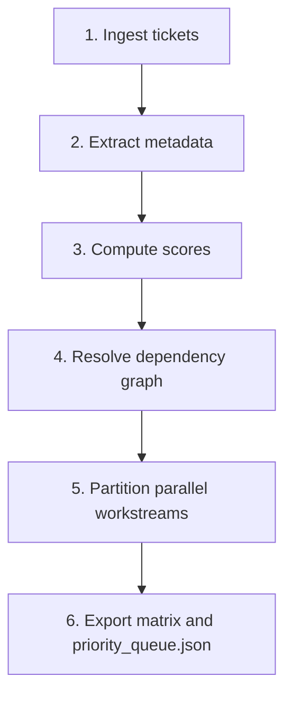

# Story Prioritizer

Audits boards, sprints, and backlogs to compute an objective, multi-factor priority score for each story. Produces an execution queue, maps technical dependencies, and identifies **parallel workstreams** that multiple developers or subagents can run concurrently without merge conflicts.

**Read-only by design.** This skill analyzes and ranks; it never changes ticket status. Status transitions belong to the implementation workflows.

---

## Core Objectives

1. **Maximize delivered value** — fast-track revenue-critical paths and core transaction flows.
2. **Close partially-built epics** — stories finishing an epic already past ~70% completion convert sunk effort into shippable value.
3. **Enforce dependency hygiene** — foundational schemas, API contracts, and auth services must be scheduled before their downstream consumers.
4. **Identify parallel tracks** — group decoupled, collision-free tickets for concurrent execution.
5. **Stay context-efficient** — emit a compact `priority_queue.json` that downstream orchestrators consume without ingesting raw ticket prose.

---

## Scoring Model

Each ticket is scored 0–100 on five weighted dimensions:

```text
Score = 0.30*BV + 0.25*CP + 0.20*DH + 0.15*PR + 0.10*UR
```

| Factor | Weight | Criteria |
| :--- | :---: | :--- |
| **Business value (BV)** | 30% | Revenue impact, core transaction flows, conversion paths |
| **Critical path and epic completion (CP)** | 25% | Completes an in-flight epic, or unblocks an entire later phase |
| **Dependency hygiene (DH)** | 20% | High when every prerequisite is already met; penalized when blocked by unstarted upstream work |
| **Parallel readiness (PR)** | 15% | High when the ticket is confined to an isolated route, module, or directory |
| **Urgency and risk (UR)** | 10% | Security exposure, abuse and fraud mitigation, deadline proximity |

Treat these weights as the **default**, not a law. When the project's own documented priorities disagree, follow the project and say which weights you adjusted and why.

---

## Workflow



### Step 1: Ingest

With a tracker MCP server, query unresolved tickets in the active sprint or target epic. For Jira:

```jql
project = <KEY> AND sprint in openSprints() AND resolution = Unresolved ORDER BY Rank ASC
```

For GitHub Issues, filter by the milestone or project board column. When specific keys are supplied as arguments, fetch each one directly. Without a tracker, accept ticket details inline from the user.

### Step 2: Analyze technical boundaries

Determine which files, layers, and modules each story touches. The categories matter because they predict conflict risk:

| Boundary | Conflict risk | Handling |
| :--- | :--- | :--- |
| **UI components only** | Low | Safe to parallelize |
| **Backend services / API routes** | Low to medium | Parallelize when the modules are disjoint |
| **Shared utilities / types** | Medium | Serialize when two tickets touch the same file |
| **Database schema / migrations** | **High** | Serialize, and schedule first |
| **Standalone routes or pages** | Low | Safe to parallelize |

Infer boundaries from the ticket's own description and the repo layout. Do not assume a framework-specific directory structure — inspect the project.

### Step 3: Identify parallel tracks

Group tickets into collision-free sets. Two tickets belong in the same group — and therefore run sequentially — when they touch any file in common. Schema changes are their own serialized group, scheduled ahead of their consumers.

**When the boundary analysis is uncertain, serialize.** A mis-parallelized pair costs a painful rebase; an over-serialized pair costs a little wall-clock time.

---

## Output

Emit both a human-readable matrix and a machine-readable artifact.

### 1. Human-readable matrix

```markdown
### Sprint Execution Queue

| Rank | Key | Summary | Stream | Est | Blocker / prereq | Group |
|:---:|:---|:---|:---|:---:|:---|:---:|
| 1 | PROJ-38 | Dynamic category integration | UI | 3 | None | A |
| 2 | PROJ-20 | Core transaction engine and locks | Backend | 8 | None | C |
| 3 | PROJ-29 | Bot-protection challenge | Security | 3 | Pair with PROJ-20 | C |
| 4 | PROJ-25 | Share-card generator | UI | 3 | None | A |
```

### 2. Machine-readable `priority_queue.json`

Write to `.speckit/sprint/priority_queue.json`:

```json
{
  "timestamp": "2026-11-02T00:00:00Z",
  "sprint": "Sprint 2",
  "queue": [
    {
      "rank": 1,
      "key": "PROJ-38",
      "title": "Dynamic category integration in the entry form and public roster filter",
      "type": "Story",
      "priority": "High",
      "points": 3,
      "score": 84,
      "stream": "frontend-roster",
      "parallelGroup": "GROUP_A",
      "branchName": "feature/PROJ-38-dynamic-category-integration",
      "prerequisites": [],
      "targetDirectories": [
        "src/features/entries/components/",
        "src/features/events/components/"
      ]
    },
    {
      "rank": 2,
      "key": "PROJ-20",
      "title": "Core transaction engine and anti-fraud checks",
      "type": "Story",
      "priority": "Highest",
      "points": 8,
      "score": 81,
      "stream": "transaction-engine",
      "parallelGroup": "GROUP_C",
      "branchName": "feature/PROJ-20-core-transaction-engine",
      "prerequisites": ["PROJ-28"],
      "targetDirectories": [
        "src/features/transactions/",
        "src/app/api/transactions/"
      ]
    }
  ]
}
```

`targetDirectories` is what downstream orchestrators use to verify that two tickets really are collision-free, so populate it from actual inspection rather than a guess.

---

## Guardrails

- **Never prioritize blocked work.** A ticket depending on an unstarted schema migration is `BLOCKED` and deferred, regardless of its score.
- **Limit WIP per stream.** Never recommend more than one ticket per developer or subagent inside the same directory boundary.
- **Never modify tickets.** Read-only analysis. Status updates belong to the implementation workflow.
- **Show the arithmetic.** When a ranking is surprising, give the per-factor scores so the user can challenge the weighting rather than just the result.
